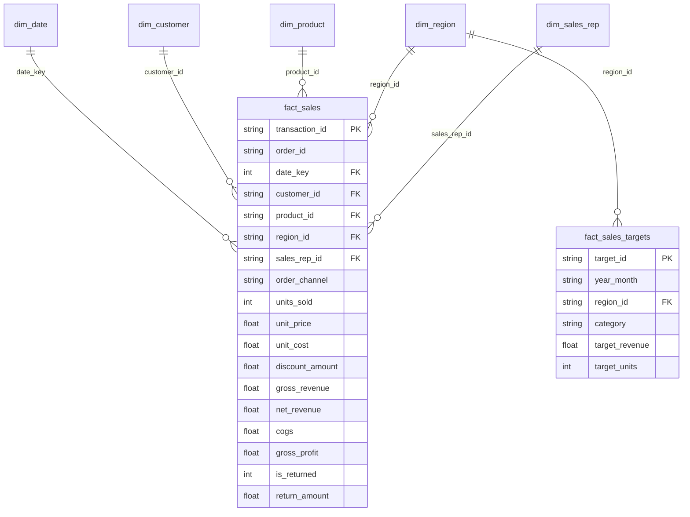

# Enterprise Sales & Business Intelligence Analytics Suite

[](https://github.com/zzzzzzzzak/enterprise-sales-bi-analytics/actions/workflows/ci.yml)
[](https://www.python.org/)
[](LICENSE)
[](tests/)
[](sql/)

A production business intelligence and data warehousing repository featuring a **normalized Star-Schema data model**, **12 core business KPIs**, and dynamic multi-dimensional drill-downs across **5 business dimensions**. Includes analytical SQL transformations (CTEs, Window Functions), a complete Power BI DAX specification library, and an interactive executive decision dashboard.

---

## The 12 Core Business KPIs

| # | Business KPI | Definition & SQL / DAX Logic | Analytical Value |
|---|---|---|---|
| **1** | **Gross Sales Revenue** | `SUM(fact_sales[gross_revenue])` | Total top-line transactional billing volume |
| **2** | **Net Sales Revenue** | `SUM(gross_revenue - discount_amount - return_amount)` | Realized cash generation after price concessions |
| **3** | **Total Units Sold** | `SUM(fact_sales[units_sold])` | Physical volume throughput across SKUs |
| **4** | **Average Order Value (AOV)**| `Net Sales Revenue / DISTINCTCOUNT(order_id)` | Order size expansion & basket size tracking |
| **5** | **Gross Margin %** | `(Net Revenue - COGS) / Net Revenue` | Unit economics and pricing power health |
| **6** | **Total Order Volume** | `DISTINCTCOUNT(fact_sales[order_id])` | Transactional frequency and platform load |
| **7** | **Active Customer Count**| `DISTINCTCOUNT(fact_sales[customer_id])` | Active buying accounts within the period |
| **8** | **Repeat Customer Ratio** | `Repeat Customers (Orders > 1) / Active Customers` | Customer stickiness and brand loyalty |
| **9** | **Product Return Rate %** | `Returned Line Items / Total Line Items` | Product quality, defect rates, and buyer friction |
| **10**| **Target Budget Revenue** | `SUM(fact_sales_targets[target_revenue])` | Financial plan baseline and quota target |
| **11**| **Budget-vs-Actual Variance**| `Actual Net Revenue - Target Budget Revenue` | Over/under performance gap for leadership |
| **12**| **Quota Attainment %** | `Actual Net Revenue / Target Budget Revenue` | Sales execution efficiency against quota plan |

---

## The 5 Drill-Down Dimensions

The data model enables drill-down slicing across 5 core enterprise dimensions:

1. **Time**: Year (2023, 2024), Quarter, Month, Week-of-Year, and Day-of-Week.
2. **Geography / Region**: North America - East, North America - West, EMEA, APAC, and LATAM.
3. **Product Hierarchy**: 4 Categories (*Hardware*, *Software*, *Cloud Solutions*, *Enterprise Services*) and 16 Subcategories.
4. **Customer Segment**: Enterprise, Mid-Market, SMB, and Public Sector across 6 industries.
5. **Sales Channel**: Direct Sales, Partner / Reseller Network, Digital Self-Service, and Inside Sales.

---

## Data Warehouse Architecture (Star Schema)



---

## Advanced SQL Modeling Highlights (`sql/02_kpi_queries.sql`)

The repository showcases production SQL transformations utilizing modern analytical constructs:

* **Month-over-Month (MoM) & Year-over-Year (YoY) Growth**: Implemented via window function `LAG()` across date partitions without self-joins.
* **Rolling 3-Month Moving Averages**: Constructed using `AVG(net_revenue) OVER (ORDER BY year_month ROWS BETWEEN 2 PRECEDING AND CURRENT ROW)`.
* **Customer Pareto Concentration (80/20 Rule)**: Uses `NTILE(10) OVER (ORDER BY spend DESC)` to quantify revenue contribution across deciles.
* **Budget vs. Actual Variance**: Multi-table CTE joining target tables against aggregated actuals with variance percentages and attainment flags.

---

## Power BI & DAX Measure Library (`dax/measures.dax`)

The `dax/` directory contains standard Power BI measures organized by business domain:
* **Time Intelligence**: `[YTD Net Sales]`, `[Same Period Last Year]`, `[MoM Sales Growth %]`, `[Rolling 3-Month Sales]`.
* **Budget Health**: `[Target Variance $]`, `[Quota Attainment %]`, and dynamic indicator `[Budget Health Status]`.
* **Cohort & Retention**: `[Repeat Customers Count]`, `[Repeat Customer Ratio %]`.

---

## Repository Structure

```
enterprise-sales-bi-analytics/
├── .github/
│   └── workflows/
│       └── ci.yml               # Automated CI test runner
├── data/
│   ├── raw/                     # Raw extraction artifacts
│   └── processed/
│       ├── sales_dw.db          # Star-schema SQLite data warehouse (40,000+ facts)
│       └── sales_kpi_summary.json# Computed 12 KPI metrics digest
├── dax/
│   └── measures.dax             # Production Power BI DAX measure formulas
├── sql/
│   ├── 01_schema.sql            # DDL star-schema table & index definitions
│   └── 02_kpi_queries.sql       # Complex CTEs, window functions & variance queries
├── src/
│   ├── __init__.py
│   ├── seed_dw.py               # Transactional data generator & SQLite seeder
│   └── kpi_engine.py            # Automated KPI calculation and reconciliation engine
├── tests/
│   ├── __init__.py
│   ├── test_schema.py           # DDL table existence and volume tests
│   ├── test_integrity.py        # Foreign key orphan & financial balance tests
│   └── test_kpis.py             # 12 KPI boundary and consistency tests
├── app.py                       # Interactive Streamlit executive BI dashboard
├── run_pipeline.py              # Single-command warehouse execution runner
├── requirements.txt             # Project dependencies
├── .gitignore                   # Python gitignore
└── README.md                    # Technical documentation
```

---

## Quickstart & Setup

### 1. Installation
```bash
git clone https://github.com/zzzzzzzzak/enterprise-sales-bi-analytics.git
cd enterprise-sales-bi-analytics

python -m venv venv
# Windows:
venv\Scripts\activate
# Linux/macOS:
source venv/bin/activate

pip install -r requirements.txt
```

### 2. Run Test Suite
```bash
pytest tests/ -v
```

### 3. Seed Warehouse & Compute KPIs
```bash
python run_pipeline.py
```

### 4. Launch Interactive BI Dashboard
```bash
streamlit run app.py
```

---

## Author

**Siddiqui Zakir Ali**  
*Senior Data Analyst | Business Intelligence | Forecasting & Performance Analytics*  
* [LinkedIn](https://linkedin.com/in/zakir-siddiqui-182b9711a)
* [GitHub](https://github.com/zzzzzzzzak)
